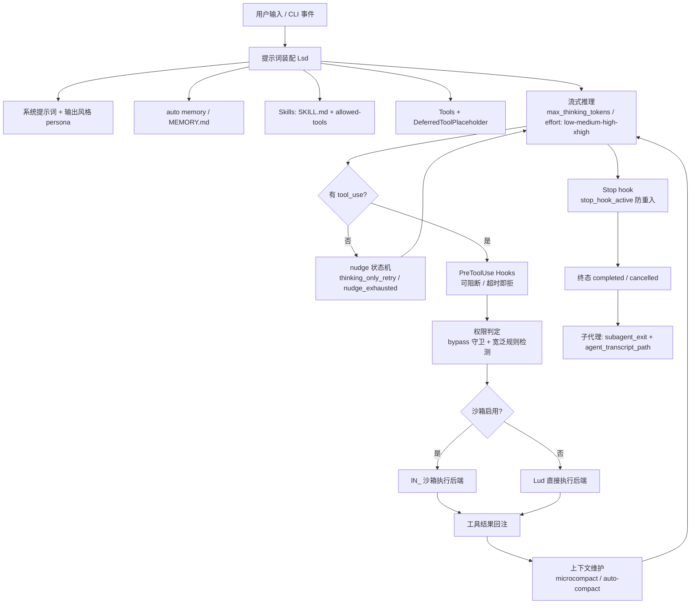

# Claude Code Agent 架构逆向分析报告

> 分析工具：Metis Reverse MCP（`metis-reverse`）
> 分析会话：`default_sess`（artifact `root`）
> 分析日期：2026-10-22 ~ 2026-10-23
> Sidecar：`/Users/huchenrui/metis-revers/.metis_sidecars/8addc857f3fe64d5a0368af9ee50321b50afb4a6918ba3ef018ab84f5dbbe081.metis.yaml`（29 条锚点注释 + 3 条分级发现）

---

## 0. 摘要

对象为 **Bun 单文件编译的 Claude Code CLI**。其 Agent 架构可以概括为：

> **一条 async generator 主循环 + 四道上下文闸门 + 三层工具执行管线。**

工作流不是"请求—响应"，而是：

```
用户输入 → 提示词装配（系统提示词 / 输出风格 / 记忆 / 技能 / 延迟工具占位）
        → 流式推理（思考预算 + effort 档位）
        → 解析 tool_use（含 nudge 重试状态机）
        → PreToolUse Hooks（可阻断，超时即拒）
        → 权限判定（bypass 守卫 / 宽泛规则检测）
        → 沙箱分支执行（lN_ / Lud 两条后端）
        → 结果回注 → 循环
        → 上下文维护（时间维度 microcompact + 窗口维度 auto-compact）
        → Stop hook → 终态 completed / cancelled → 子代理写 subagent_exit
```

关键结论（每条均有 2 处以上独立证据）：

1. 主循环是 `async function*`，沙箱启用与否是**两条独立执行路径**，不是运行时 if。
2. 工具描述**按需注入**（`ToolSearch` + `DeferredToolPlaceholder`），把 MCP 全量工具从固定 token 税变成按需付费。
3. Hooks **fail-closed**：`PreToolUse` 超时不响应则工具**不执行**。
4. 压缩提示词以"用户显式请求与意图"为第一优先级，而非按时间顺序摘要。
5. 权限是显式命名的守卫函数族（可测试、可审计），能识别"合法但过度宽泛"的 Bash 规则。
6. 沙箱网络隔离靠**本地代理 + 注入 CA 证书**，macOS 文件防护依赖 interposer，未就绪时降级为默认拒绝。

---

## 1. 分析对象与产物形态

### 1.1 构建形态

- 单个 **Bun standalone 可执行文件**（`bun build --compile` 形态）。
- artifact 树同时包含：
  - **运行时区**：Bun 的 `ffi` / `sql` 实现，闭包包括 `initializeSQL`、`createChangesObject`、`getController(db, _self)`、`transaction`、`addAbortListener`。
  - **应用 bundle**：入口 `src/entrypoints/cli.js`（artifact `root:js:3`）。
  - **vendored 依赖**：`mermaid.min.js`、`ajv`（`raw.githubusercontent.com/ajv-validator/ajv/master/lib/refs/data.js`）。
- 字符串以**长度前缀表**内嵌（`\u0000` 分隔），因此字符串检索可直接命中提示词原文与内部常量名。

### 1.2 取证限制

bundle 被压成超长单行，Metis 的单行护栏会截断（即使 `max_chars` 设大也只返回片段）。因此本报告对提示词采用**"行号锚点 + 片段"**方式取证，不做逐字全文 dump。

### 1.3 持久化与会话控制面

会话持久化走内嵌 SQLite（`initializeSQL` / `getController` / `transaction`），并暴露一组会话 API：

- `setSessionPersistenceDisabled`
- `setSessionOverridesGetter`
- `setSessionIngressToken`
- `setSessionBypassPermissionsMode`
- `getSessionId` / `getSessionCounter`
- `getSessionCronTasks`
- `getSessionCreatedTeams`

→ 说明支持**远程 / 托管 ingress 会话**，以及按会话挂载**定时任务**与**代理团队**。

---

## 2. 总体架构



---

## 3. 主循环

### 3.1 生成器即循环

证据锚点：`claude` 模块第 **3704190** 行。

```js
async function*Xse(e){
  let t=[],r;
  try{ r = yield* Btn() ? lN_(e,t) : Lud(e,t) }
  finally{
    let o = e.toolUseContext.agentId;
    if(o) two(o,"subagent_exit",e.querySource)
  }
  let n = mCo(r.reason) ? "cancelled" : "completed"
  ...
}
```

可读出四个设计：

1. **生成器即循环**：`Xse` 通过 `yield*` 把控制权交给下游执行体，外层只负责终态判定，天然支持流式消费与中断。
2. **按沙箱开关分叉**：`Btn() ? lN_(e,t) : Lud(e,t)` —— 沙箱与直连是两套独立执行后端。
3. **子代理遥测钩在 `finally`**：只要 `toolUseContext.agentId` 存在，退出必发 `subagent_exit`（带 `querySource`），保证生命周期不漏记。
4. **终态只有两种**：`cancelled` / `completed`，错误被吸收进 reason。

### 3.2 nudge 重试状态机

证据锚点：**2059244**。

```
query_thinking_only_response → nudged → thinking_only_retry → nudge_exhausted
                                                            ↘ api_error
```

模型"只输出思考、不调工具"时会被推一把重试；连续失败才收敛为错误。这是"Agent 不会空转"的机制来源。

### 3.3 思考预算与推理档位

- `max_thinking_tokens` 字段：**1836509**
- `onSetMaxThinkingTokens` / `setMaxThinkingTokens`：**2141729**、**2452555**
- 推理努力档位：`low` / `medium` / `high` / `xhigh`（"Persisted effort level"）：**1699523**

### 3.4 SDK / 宿主控制面

**2452555** 处可见 `initialModel`、`hostOwnsPermissionMode`、`setModel`、`setPermissionMode`、`setMaxThinkingTokens`。

→ 模型与权限模式可以由 **SDK 宿主接管**，不只是 CLI 自己决定（对应 `hostOwnsPermissionMode` 的语义）。

---

## 4. 提示词体系

### 4.1 系统提示词开头与输出风格

证据锚点：**3492837**。

```text
Explanatory … Claude explains its implementation choices and codebase patterns …
You are an interactive CLI tool that helps users with software engineering tasks. In …
```

- 输出风格注册表与系统提示词**相邻存放**，说明输出风格不是硬编码分支，而是**可整体替换的 persona 层**。
- 已知至少存在 `Explanatory`（解释实现选择与代码库模式）与默认风格。

### 4.2 行为约束

| 约束 | 原文片段 | 锚点 |
| --- | --- | --- |
| 最小改动 / 诚实性 | `NEVER create files unless they're absolutely necessary for achieving your goal. ALWAYS prefer editing an existing file to creating a new one.` | 3702570 |
| 洞察归属 | `These insights should be included in the conversation, not in the codebase…` | 3492833 / 3720321 |
| 洞察取舍 | `…focus on interesting insights that are specific to the codebase or the code you just wrote…` | 3720321 |

含义：把"解释"与"落盘"分离，防止 Agent 把评审意见写进仓库。

### 4.3 计划模式引导

| 锚点 | 原文 |
| --- | --- |
| 1981527 | `**Prefer using EnterPlanMode** for implementation tasks unless they're simple. Use it when ANY of these conditions apply:` |
| 1981554 | `If you would use [AskUserQuestion] to clarify the approach, use EnterPlanMode instead` |
| 1619842 | `EnterPlanMode` / `AskUserQuestion` 工具注册（`Asks the user multiple choice questions to gather information, clarify ambiguity, understand preferences, make decisions…`） |

→ 明确了"先规划再动手"的路由优先级，而不是让模型自由选择。

### 4.4 压缩（compact）提示词

起点锚点：**3310393**。

```text
Your task is to create a detailed summary of the conversation so far, paying close attention
to the user's explicit requests and your previous actions.
```

结构为编号清单，第一项（锚点 **3310414**、**3310434**）：

```text
1. Primary Request and Intent: Capture all of the user's explicit requests and intents in detail
```

→ 压缩以**"用户显式请求与意图"为第一优先级**，属于目标保持型摘要，而非时间顺序摘要。

### 4.5 Auto memory 指令

证据锚点：**1750231**（`# auto memory` 标题 + `{memory_dir}` 模板变量），配套：

- `MEMORY.md` 索引（**1831962**，可见 `user` 作用域条目）
- memory-discovery 分区挂载逻辑（**1747925**、**1748400**，失败时提示 `…failed the partition pin / not mounting`）

→ 记忆是**文件系统 + 目录挂载**形态，不是向量库。

---

## 5. 上下文工程

### 5.1 两条压缩路径

| 类型 | 证据 | 语义 |
| --- | --- | --- |
| 窗口级 auto-compact | `Auto-compact window: ` + `auto` 模式（**2207108**） | 按模型上下文窗口比例触发整段摘要 |
| 时间级 microcompact | 埋点名 `tengu_time_based_microcompact`（**1983689**） | 按"时间"而非 token 数做定点清理（推断：清理过期工具结果/日志，避免一次性大压缩丢信息） |

### 5.2 请求装配

函数 `Lsd(e)`（锚点 **3703560**）接收：

```
system / toolSchemas / anyDeferLoading / querySource / model / agentId /
fastMode / globalCacheStrategy / betas / autoModeActive / isUsingOverage / is1hCacheTT…
```

→ prompt caching 是**分层策略**：全局缓存策略 + 1 小时 TTL 开关 + beta 头；`anyDeferLoading` 会参与每轮请求构建（与 ToolSearch 联动）。

---

## 6. 工具面与延迟加载

### 6.1 已确认的工具名

内置核心（多个锚点交叉）：

- 文件/命令：`Read`、`Write`、`Edit`、`Bash`、`BashOutput`、`KillShell`、`Grep`、`Glob`、`NotebookEdit`
- 检索/网络：`WebSearch`、`WebFetch`、`ToolSearch`
- 交互/编排：`AskUserQuestion`、`EnterPlanMode`、`ExitPlanMode`、`TodoWrite`、`Task`、`TaskGet`、`TaskUpdate`、`SendMessage`、`SendUserFile`、`ListAgents`、`ListPeers`、`Brief`、`TeamCreate`、`Workflow`、`ExitWorktree`、`StructuredOutput`
- 定时：`CronCreate`、`CronDelete`、`CronList`
- 技能/MCP：`Skill`、`ListMcpResources`、`ReadMcpResource`、`ReadMcpResourceDir`
- 占位：`DeferredToolPlaceholder`

锚点示例：**2978605**（`BashOutput` / `ListPeers` / `Brief` / `ListMcpResources` / `ReadMcpResource` / `ReadMcpResourceDir` 连续排列）、**1619842**（`EnterPlanMode` / `AskUserQuestion`）、**1619435**（`SendUserFile({files:["report.md"], caption:"Here's the report.", status:"normal"})` 用法示例）。

### 6.2 延迟工具加载（关键机制）

| 锚点 | 证据 |
| --- | --- |
| 1619231 | `ToolSearch` + `DeferredToolPlaceholder`；描述：`Reserved placeholder that keeps deferred tool loading active; never call this tool.` |
| 1630552 | `ToolSearch` 查询语法：`select:mcp__claude-in-chrome__tabs_context_mcp,mcp__claude-in-chrome__navigate,mcp__claude-in-chrome__computer,…` |
| root:js:3:83353 | 同一常量在 `src/entrypoints/cli.js` 中重复出现（确认属于应用层而非运行时） |

→ 用一个"永不调用"的占位工具把延迟加载机制撑住；需要时按 `select:` 语法精确拉取工具 schema。

### 6.3 MCP 集成

- 命名统一 `mcp__<server>__<tool>`，共命中 322 处。
- 兼容带下划线的 server 名：`mcp__github_inline_comment__create_inline_comment`（**1632153**）。
- Claude in Chrome 扩展工具集：`mcp__claude-in-chrome__tabs_context_mcp` / `navigate` / `computer` / `read_page` / `tabs_create…`（**1630552**）。
- 未安装扩展时的降级提示：`The user started installing the Claude in Chrome extension but chose to continue without browser tools. Do not suggest th…`（**1632118**）。

---

## 7. 子代理、团队与委派

### 7.1 委派判据

Task 工具描述原文（UTF-16 存储，锚点 **1619453**）：

```text
Delegate for work that is genuinely independent, large enough to justify a fresh context, or natural…
```

→ 委派条件 = "真正独立 / 大到值得开新上下文"，**不是"能并行就并行"**。

### 7.2 代理类型定义

锚点 **2119957**：

```text
- Each agent type's model, reasoning effort, and tools come from its definition
  (`.claude/agents/*.md` frontmatter or SDK `agents`).
```

目录常量（**1772597**）：`.claude/commands` 与 `.claude/agents` 并列。
插件代理限制（**1867975**）：`mcpServers` 对 plugin agents 被忽略，需要 `.claude/agents/` 才能做同级控制。

### 7.3 内建 explore 代理

锚点 **3702558**：

```js
… Complete the user's search request efficiently and report your findings clearly.`}
function FVe(e,t){
  if(e.agentType!==BFe.agentType || e.source!=="built-in") return e.model;
  if(Z.CLAUDE_CODE_DISABLE_EXPLOR…
```

→ 内建 explore 代理有独立提示词与模型路由；受 `CLAUDE_CODE_DISABLE_EXPLORATION` 环境变量门控。

### 7.4 团队

- `TeamCreate` 工具（**3214688**、**3214690**）
- 会话 API `getSessionCreatedTeams`（**1657393**）
- 同伴通信：`SendMessage` + `ListPeers` / `Brief`
- Hook 输入字段（**2275442**）：`session_crons`、`stop_hook_active`、`agent_transcript_path`、`extendedHookInput`

→ 子代理有独立 transcript 文件；Stop hook 可感知是否已处于 stop-hook 重入。

---

## 8. Hooks

### 8.1 事件表

锚点 **1636854**（文档化表格）：

```text
| PreToolUse | Tool name | Run before tool, can block |
```

工具类事件限定（**1636877**、**1636883**）：

```text
Only available for tool events: PreToolUse, PostToolUse, PermissionRequest.
```

### 8.2 失败语义（安全默认值）

锚点 **1629980**：

```text
PreToolUse hook did not respond before its timeout (host client may be unreachable).
The tool call was not executed; other configured hooks may not have completed.
```

→ Hook 由 **host client 远程执行**；超时 = **拒绝执行（fail-closed）**。这是刻意选择的安全默认值，不是 fail-open。

---

## 9. 权限与沙箱

### 9.1 权限守卫函数族

锚点 **1658318**、**1658321**（名称连续成组，属于同一模块）：

```text
shouldDisableBypassPermissions
setPermissionModeWithGuards
restoreDangerousPermissions
removeDangerousPermissions
prepa…
findOverlyBroadBashPermissions
findDangerousClassifierPermissions
createDisabledBypassPermissionsContext
checkAndDisableBypass…
```

会话级：`setSessionBypassPermissionsMode`（**1657358**）。

设计含义：

- `bypassPermissions` 不是简单布尔开关，而是带**守卫与回滚**的模式切换（`restoreDangerousPermissions` 表明切换会临时放宽再恢复）。
- `findOverlyBroadBashPermissions` / `findDangerousClassifierPermissions` 说明会静态检测"看起来合法但覆盖过宽"的规则（如 `Bash(*)`）。

### 9.2 沙箱参数构建

锚点 **3701349**，函数 `Xbu(e)` 解构：

```
command / needsNetworkRestriction / httpProxyPort / socksProxyPort /
proxyAuthToken / caCertPath / allowUnixSockets / allowAllUnixSockets
```

→ 网络隔离靠**本地 HTTP/SOCKS 代理 + 注入 CA 证书**实现，而不是简单断网。

### 9.3 平台差异

锚点 **1775960**：

```text
[Sandbox macOS] file mask degrades to deny on macOS until the interposer lands
```

→ macOS 文件系统防护依赖 **interposer**；未就绪时**降级为默认拒绝**（同样 fail-closed）。

---

## 10. 扩展机制：Skills / Plugins / Slash Commands

| 机制 | 证据 | 说明 |
| --- | --- | --- |
| Skills | `SKILL.md` 常量（**1750387**） | 技能目录约定 |
| 技能工具白名单 | frontmatter `allowed-tools` / `disallowed-tools`（**1870676**） | 技能自带工具收窄，加载即限权 |
| 技能共享 | `## Sharing skills in memories`（**1750388**） | 技能可随记忆共享；原文强调"仅在用户明确要求时创建/编辑共享记忆技能" |
| Plugins | `.claude-plugin/plugin.json`（或 `SKILL.md` frontmatter）自动加载整个目录（**1863504**） | 目录即插件 |
| 插件加载失败路径 | `[skill-as-plugin] failed to read`（**1837100**） | 兜底错误 |
| Slash commands | `# claude_args: '--allowedTools Bash(gh pr *)'`（**1630780**） | 命令级工具授权 |
| 设置层 | Vim 键位重映射 `{"jj": "<Esc>"}`（**1699528**） | 设置是统一 schema，非散落开关 |

---

## 11. 完整工作流（还原）

1. **启动**：装配提示词（系统提示词 + 输出风格 persona + auto memory + skills/rules + 延迟工具占位）→ 建立 SQLite 会话与 ingress token。
2. **输入**：用户输入 → `Lsd` 构建请求（system / toolSchemas / betas / cache 策略）。
3. **推理**：流式推理，携带 `max_thinking_tokens` 与 effort 档位。
4. **判定**：模型产出 tool_use → 若是"只思考不行动"则进 nudge 状态机。
5. **拦截**：`PreToolUse` hook（可阻断；超时即拒）。
6. **授权**：权限守卫（bypass 校验 + 宽泛规则检测）。
7. **执行**：沙箱分支 `lN_` 或直连 `Lud`。
8. **回注**：工具结果写回上下文 → 回到第 3 步。
9. **维护**：`tengu_time_based_microcompact` 做时间维度清理；接近窗口上限时 `Auto-compact window` 触发整段摘要（按"用户显式意图"优先）。
10. **收尾**：Stop hook（`stop_hook_active` 防重入）→ 终态 `completed` / `cancelled` → 子代理写 `subagent_exit` 与独立 transcript。
11. **旁路能力**：Task/团队委派、Cron 定时、Worktree 退出、StructuredOutput、MCP（`mcp__` + ToolSearch 按需 select）。

---

## 12. 设计取舍（可借鉴的五点）

1. **沙箱是双后端，不是开关**：两条循环路径让沙箱后端可以独立演进、独立测试。
2. **工具描述按需注入**：`ToolSearch` + 占位符把 MCP 全量工具从"固定 token 税"变成"按需付费"。
3. **Hook 失败即拒绝**：安全默认值明确，不依赖调用方自觉。
4. **压缩以意图为锚**：长会话不丢原始目标，优于时间顺序摘要。
5. **权限是显式守卫函数族**：可测试、可审计，且能识别"合法但过度宽泛"的规则。

---

## 13. 证据索引

模块：`claude`（行号即锚点，可用 `js_search` / `js_get_module` 复现）。

| 行号 | 主题 |
| --- | --- |
| 1619231 | `ToolSearch` / `DeferredToolPlaceholder`：延迟工具加载占位符 |
| 1619453 | Task 工具委派判据（UTF-16 存储） |
| 1619842 | `EnterPlanMode` / `AskUserQuestion` 工具注册 |
| 1629980 | `PreToolUse` hook 超时即拒绝执行 |
| 1630552 | `ToolSearch` 的 `select:mcp__…` 语法（Claude in Chrome） |
| 1630780 | Slash command frontmatter `# claude_args: '--allowedTools …'` |
| 1632118 | Claude in Chrome 未安装时的降级提示 |
| 1632153 | MCP 工具名含下划线的兼容写法 |
| 1636854 | Hooks 事件表（`PreToolUse` 可阻断） |
| 1636877 | 工具类 hook 事件限定（PreToolUse / PostToolUse / PermissionRequest） |
| 1657358 | 会话 API：`setSessionBypassPermissionsMode` 等 |
| 1657393 | 会话 API：`getSessionCronTasks` / `getSessionCreatedTeams` |
| 1658318 | 权限守卫：`shouldDisableBypassPermissions` / `setPermissionModeWithGuards` |
| 1658321 | 危险权限检测：`findOverlyBroadBashPermissions` / `findDangerousClassifierPermissions` |
| 1699523 | 推理努力档位 `low/medium/high/xhigh` |
| 1699528 | Vim 键位重映射设置 |
| 1747925 / 1748400 | memory-discovery 分区挂载与失败提示 |
| 1750231 | `# auto memory` + `{memory_dir}` 模板变量 |
| 1750387 | `SKILL.md` 常量 |
| 1750388 | `## Sharing skills in memories` |
| 1772597 | `.claude/commands` + `.claude/agents` 目录常量 |
| 1775960 | macOS 沙箱 interposer 降级为 deny |
| 1831962 | `MEMORY.md` 索引与 `user` 作用域 |
| 1836509 | `max_thinking_tokens` |
| 1837100 | `[skill-as-plugin] failed to read` |
| 1863504 | `.claude-plugin/plugin.json` / `SKILL.md` frontmatter 自动加载 |
| 1867975 | plugin agents 忽略 `mcpServers`，需 `.claude/agents/` |
| 1870676 | 技能 frontmatter `allowed-tools` / `disallowed-tools` |
| 1981527 | `EnterPlanMode` 使用引导 |
| 1981554 | "要用 AskUserQuestion 澄清 → 改用 EnterPlanMode" |
| 1983689 | `tengu_time_based_microcompact` 埋点 |
| 2059244 | 主循环终态枚举：`nudged` / `thinking_only_retry` / `nudge_exhausted` / `api_error` |
| 2119957 | 代理类型定义：`.claude/agents/*.md` frontmatter / SDK `agents` |
| 2141729 | `onSetMaxThinkingTokens` / `onSetPermissionMode` 等回调 |
| 2207108 | `Auto-compact window` 常量 |
| 2275442 | `stop_hook_active` / `agent_transcript_path` / `extendedHookInput` / `session_crons` |
| 2452555 | SDK 控制面：`hostOwnsPermissionMode` / `setModel` / `setPermissionMode` |
| 2978605 | 工具名连续排列：`BashOutput` / `ListPeers` / `Brief` / `ListMcpResources` 等 |
| 3214688 / 3214690 | `TeamCreate` |
| 3310393 | 压缩提示词起点 |
| 3310414 / 3310434 | 压缩提示词 Section 1：`Primary Request and Intent` |
| 3492833 / 3720321 | 洞察写入对话而非代码库 |
| 3492837 | 输出风格 `Explanatory` + 系统提示词开头 |
| 3701349 | 沙箱参数构建器（代理端口 / CA / Unix socket） |
| 3702558 | 内建 explore 代理 + 模型路由 `FVe`（`CLAUDE_CODE_DISABLE_EXPLORATION`） |
| 3702570 | `NEVER create files unless they're absolutely necessary…` |
| 3703560 | 请求装配 `Lsd`（`anyDeferLoading` / `betas` / `globalCacheStrategy` / `is1hCacheTT`） |
| 3704190 | 主循环 `Xse`（`lN_` / `Lud` 双后端、`subagent_exit`、`cancelled`/`completed`） |

---

## 14. 局限与后续

**局限**

1. bundle 为超长单行压缩，单行读取被护栏截断，提示词只做了"起点 + 片段"级还原，未输出逐字全文。
2. sidecar 的分级器默认把发现标为 `hypothesis`（confidence 0.5），但每条均有 2 处以上独立字符串/符号证据。
3. "时间维度 microcompact"的具体清理策略属于**推断**，未取到实现细节。

**后续建议**

1. 对关键提示词按**字符区间切片**（`slice_mode: range`），而不是整行读取，可拿到完整原文。
2. 用 `re_decompile_function` 针对 `Xse` / `Lsd` / `Xbu` / `FVe` 出伪代码，补全控制流细节。
3. 用 `re_query_evidence` 在后续会话中直接复用上述锚点。

---

## 附录：复现检索清单

```text
tool: js_search (artifact_id=root, session_id=default_sess)
query 示例：
  "interactive CLI tool that helps users with software engineering"
  "Your task is to create a detailed summary of the conversation so far"
  "Primary Request and Intent"
  "# auto memory"
  "DeferredToolPlaceholder" / "select:mcp__"
  "PreToolUse" / "PermissionRequest"
  "bypassPermissions" / "findOverlyBroadBashPermissions"
  "sandbox-exec" / "interposer"
  "TeamCreate" / ".claude/agents"
  "Auto-compact window" / "tengu_time_based_microcompact"
  "maxThinkingTokens" / "stop_hook_active"
```
