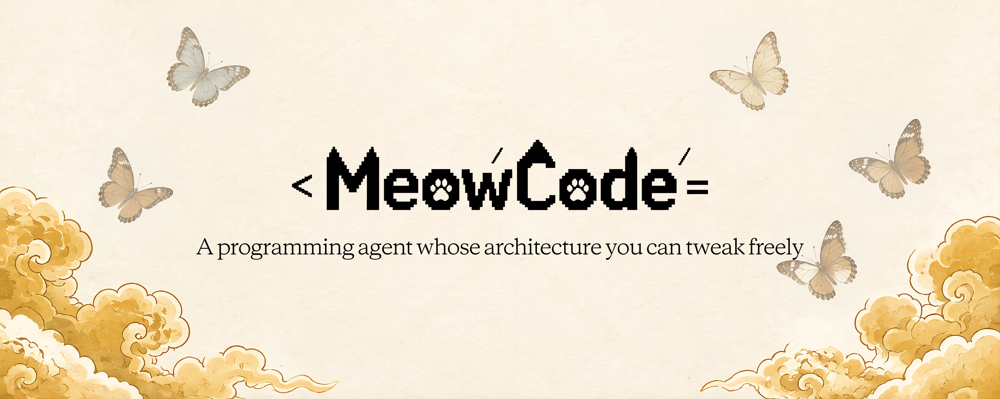
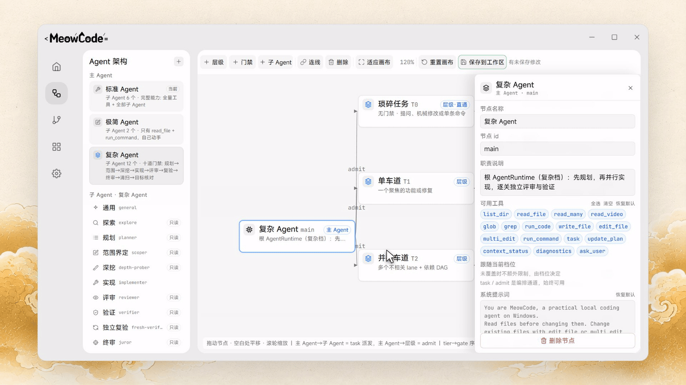
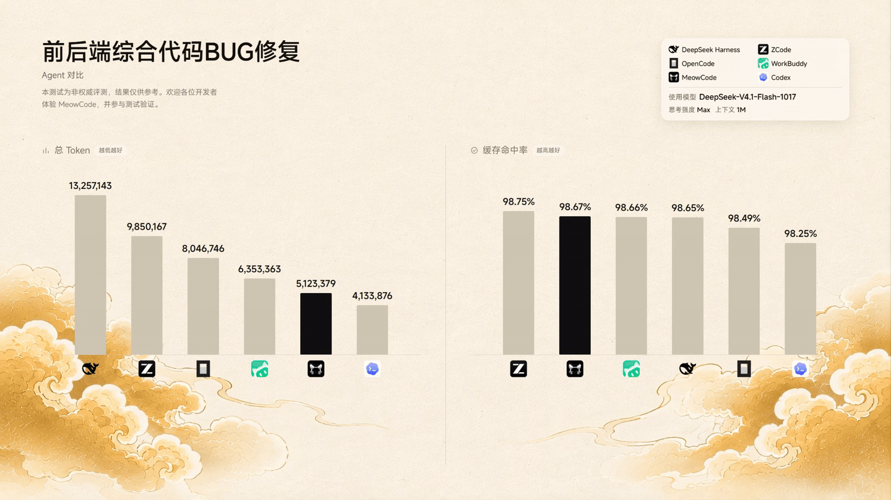

<p align="center">
  
</p>

<h1 align="center">MeowCode —— 可自由修改架构的Agent</h1>

<p align="center">
  <a href="https://meowcode.cn"></a>
  <a href="https://github.com/MuLiuSaMa/MeowCode"></a>
  <a href="https://gitee.com/muliuawa/MeowCode"></a>
  <a href="https://gitcode.com/MuLiuSaMa/MeowCode"></a>
  
  
</p>

一个**架构可以随你改**的本地编程 Agent 桌面应用。

Electron + React 负责界面，Agent 内核跑在本地 HTTP/SSE 服务里，UI 与内核只通过事件流通信——所以内核可以单独跑、单独换、单独重写，不会牵动界面。

## 亮点

-   **内核与界面彻底解耦**：`pnpm dev:server` 就能脱离 Electron 单独跑，任何 HTTP 客户端都能接入。
-   **不是黑盒**：工具调用、审批、压缩、缓存策略全是 `src/agent/` 里的普通 TypeScript，改完即生效，没有打包魔法。
-   **认真对待 Token**：服务端原生压缩 + 本地摘要 + 工具输出三层治理 + 输出预算预检，长会话不容易崩。
-   **本地优先**：会话、密钥、日志都留在本机；密钥进内存即从环境变量抹除，不落盘。

## 功能特性

**模型接入**

-   支持 Anthropic Messages、OpenAI Chat Completions、OpenAI Responses 三种协议。
-   内置常用服务商目录（DeepSeek、Kimi、通义、智谱、OpenRouter 等），也可完全自定义。
-   模型能力画像：思考预算档位、提示缓存 TTL / 断点、PDF 与图片输入门禁。
-   服务商故障自动切换（timeout / 限流 / 5xx），异常退出不打断回合。

**工具与审批**

-   文件与搜索：`list_dir` / `read_file` / `glob` / `grep`（内置 ripgrep）/ `write_file` / `edit_file` / `multi_edit`。
-   命令执行：`run_command` 运行 PowerShell，长输出自动截断，高危命令给出风险提示。
-   审批四档：`read-only` / `ask` / `auto` / `full`；写文件与命令默认弹出 diff 审批，审批期间文件被外部改动会自动刷新 diff。
-   子 Agent（`task`）：每回合最多 3 个并发，可后台运行，子 Agent 的写操作审批记在父会话上。

**会话**

-   三种模式：`default` 常规对话；`plan` 只读研究并输出计划文档，确认后才实施；`goal` 围绕目标用 `update_plan` 自主推进。
-   本地持久化、断点恢复、上下文压缩、自动会话标题、会话搜索与分支回溯。
-   项目指令：自动读取工作区根目录与 `.meowcode/AGENTS.md` 作为项目级指引。

**Token 效率**

-   服务端原生压缩（Anthropic `compact_20260112` / OpenAI `/responses/compact`）。
-   本地摘要双路径，复用前缀命中提示缓存。
-   工具输出三层治理：淘汰 / 抽头尾 / 模型纪要。
-   逐请求输出预算预检，按真实用量锚点收紧 `max_tokens`。
-   PTC `run_code`：写操作与命令仍走宿主审批。
-   MCP schema 瘦身与 8k 预算（保名字、按档砍描述）。
-   读区间并集短路与跨回合结果去重。
-   摘要失败时的零模型兜底与连续失败熔断。

**桌面集成**

-   内置终端（node-pty）、Agent 浏览器面板（打开页面 / 截图 / 点击 / 输入）。
-   侧边聊天 `Ctrl+Alt+S`、文件快开 `Ctrl+P`、终端 `` Ctrl+` ``。
-   图片输入：用户附图与截图回传，取决于所配模型的输入模态。

**插件与技能**

-   进程内 TypeScript 插件、MCP 客户端、markdown 命令与 `SKILL.md` 技能。
-   插件市场一键安装；目录约定 `<工作区>/.meowcode/` 与全局 `~/.meowcode/`，项目级覆盖用户级。

**自我学习（实验性）**

自我学习不是微调模型，而是把每回合验证过的经验写成本地可审阅的制品，在后续会话里按需召回；所有产物都是 Markdown/JSON，随时可以查看、修改或删除。

-   **默认关闭**，在「设置 → 自我学习」开启，或启动时设置 `MEOWCODE_SELF_LEARNING=1`。开启后每回合结束自动复盘，把值得复用的经验沉淀下来。
-   **先观察，再决定学不学**：只有用户纠正、明确要求记住、同一命令反复失败、失败后恢复、工具调用密集这几类回合才会触发学习；普通回合连学习模型都不调用，成本可控。
-   **四类产物**：用户画像（沟通风格 / 严谨程度 / 自主权 / 编码风格 / 工具链 / 领域）、带触发条件的项目经验、可复用的 `SKILL.md` 技能，以及只记录、不执行的工作流建议。
-   **试用期机制**：新条目先标记为 `tentative`；被召回后帮上忙达到 3 次且没有帮倒忙才转正为 `active`，帮倒忙 2 次自动退役为 `retired`（文件保留，不再召回）。另有 15% 的回合作为对照组，避免把噪声当成经验。
-   **按需召回**：用户画像每会话注入 system；项目经验只在命令、报错、关键词或文件模式命中时追加到回合尾部；技能索引常驻，模型看到需要时自己读取全文。这样不会每回合重写提示词、破坏前缀缓存。
-   **安全边界**：学习产物只允许 Markdown 与自有 JSON，绝不产出可执行工具、hook 或配置；路径越界、控制面工具、绕过验证、配置文件、密钥等内容会被守卫拒绝或脱敏。
-   **可审计、可回滚**：每次学习都记入 `helped/hurt` 账本与 `journal.jsonl`，覆盖前保存历史快照；设置页可以回滚单条技能、重新放回试用期或删除，也能一键「立即整理」合并近义经验。
-   **成本与熔断**：学习请求单飞执行，每日最多 40 次模型调用，学到的技能上限 20 个；任何一步失败都静默降级，不会影响当前对话。
-   **存放位置**：跨项目产物在 `~/.meowcode/learning/`，项目级产物在 `<工作区>/.meowcode/learning/`，项目级优先；包含 `profile.json`、`guidelines.json`、`skills/`、`ledger.json` 等文件，可直接查看和备份。

## 架构

### 编排可视化



Agent 架构编辑器

主 Agent 与子 Agent 的关系、层级（T0 / T1 / T2）、门禁条件、可用工具与系统提示词都是可编辑的节点。改完保存即生效，不用改代码，也不用重新编译。

### 运行时分三层

```
┌─────────────────────── Electron 桌面端 (desktop/) ───────────────────────┐
│  React 渲染层 (Vite)  ◀──── IPC ────▶  主进程 (main.cjs)                  │
│  会话 UI · 审批 diff · 终端 · 浏览器面板 · 设置                             │
└──────────────────────────────────┬───────────────────────────────────────┘
                                   │ HTTP + SSE 事件流
┌──────────────────────────────────▼───────────────────────────────────────┐
│  本地 Agent Server (src/server)                                           │
│  会话读写 · 事件广播 · 工作区文件访问 · 插件与市场管理                       │
└──────────────────────────────────┬───────────────────────────────────────┘
                                   │ 进程内调用
┌──────────────────────────────────▼───────────────────────────────────────┐
│  Agent 内核 (src/agent)                                                   │
│  runtime 循环 · 工具分派 · 审批 · 上下文压缩 · 缓存策略 · 故障切换           │
└──────────┬───────────────────────────────────────────┬───────────────────┘
           │ 三种协议                                   │ 工具
           ▼                                           ▼
  Anthropic Messages                          文件 / 命令 / 搜索 / 子 Agent
  OpenAI Chat Completions                     浏览器 / MCP / 插件 / 技能
  OpenAI Responses
```

## 实测

同一道「前后端综合代码 BUG 修复」任务，六款 Agent 在同一模型（DeepSeek-V4.1-Flash-1017，思考强度 Max，上下文 1M）下的对比：



-   **总 Token**：5,123,379，最高比DeepSeek Harness减少了61.36%
    
-   **缓存命中率**：98.67%，在保证使用较少Token的情况下缓存命中率仍排名第二。
    
    \*数据为非权威评测，仅供参考。

## 快速开始

需要 Node.js 20+ 与 pnpm。

```powershell
pnpm install
pnpm dev:desktop
```

首次启动后在设置里填入服务商 API Key 与模型列表。密钥只保留在 agent server 内存中，不会落盘。

## 常用脚本

| 命令 | 说明 |
| --- | --- |
| `pnpm dev:desktop` | 启动桌面端开发环境（Vite + Electron） |
| `pnpm dev:server` | 单独以 watch 模式跑 agent server |
| `pnpm build` | 编译 agent（TSC）并构建桌面端渲染层 |
| `pnpm test` | 运行 vitest 单元测试 |
| `pnpm lint` | oxlint 检查 `src` 与 `desktop/src` |
| `pnpm package` | 构建并打包 Windows x64 NSIS 安装包（输出到 `desktop/release`） |

## 目录结构

```
src/agent       Agent 内核：工具定义与执行、provider 分派、runtime、会话存储、压缩、缓存
src/agent/learning  自我学习：信号观察、经验蒸馏、召回、试用期评估与回滚
src/server      本地 HTTP/SSE 服务：会话、事件流、工作区文件访问、插件与市场
src/plugins     进程内插件宿主、MCP 客户端、命令与技能加载
src/lsp         语言服务反馈
desktop         Electron 桌面应用：React 渲染层、主进程、终端、浏览器宿主
resources       应用图标与插件市场内置资源
scripts         构建、图标生成、市场与端到端校验脚本
assets          README 截图与配图
```

## Agent Server 环境变量

| 变量 | 说明 |
| --- | --- |
| `MEOWCODE_PROVIDERS` | 服务商配置 JSON（由桌面端注入，读取后立即从环境变量删除） |
| `MEOWCODE_SERVER_TOKEN` | 本地服务鉴权 token（未提供时随机生成） |
| `MEOWCODE_SESSIONS_DIR` | 会话存储目录，默认 `%APPDATA%\MeowCode\agent\sessions` |
| `MEOWCODE_WORKSPACE` | 默认工作区目录 |
| `MEOWCODE_SERVER_PORT` | 服务监听端口，默认随机分配 |
| `MEOWCODE_SELF_LEARNING` | 自我学习开关，`1` / `true` / `on` 开启；默认关闭 |

## 安全说明

-   API Key 注入 server 后立即从环境变量删除；`run_command` 默认过滤敏感环境变量，避免模型通过子进程读回密钥。
-   写文件与命令执行默认需要审批；只有 `full` 模式允许读写工作区之外的路径。
-   会话与密钥数据仅保存在本机。

## 参与贡献

欢迎 Issue 与 PR。完整流程、代码分层导览与提交规范见 [CONTRIBUTING.md](./CONTRIBUTING.md)。

提交前请确认这四项全绿（与 CI 一致）：

```powershell
pnpm lint
pnpm build:agent
pnpm --filter @meowcode/desktop typecheck
pnpm test
```

## 许可证

本项目以 **GNU General Public License v3.0 or later** 发布，完整许可证文本见 [LICENSE](./LICENSE)。

这意味着你可以自由使用、修改、分发（包括商用），但**分发修改后的版本时必须同样以 GPL-3.0 开源**，并保留版权与许可声明。软件按“现状”提供，不附带任何担保。